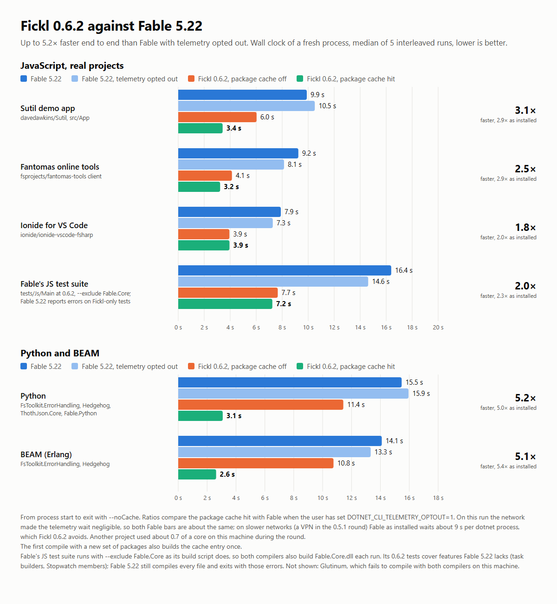

# Fickl: Fable Performance Lab

This repository is the fork of [Fable](https://github.com/fable-compiler/fable) that refrains from work on bringing cross-language targetting to parity, and instead focuses on two main objectives, in order of priority:

1. Performance and ergonomics of the Fable compiler
2. Explicit control of expression
3. Transparency

## Performance and ergonomics

The fable compiler owns a slice of the F# Compiler, and distributes it as a tool. This includes: a slim version of FSharp.Compiler.Services, and FSharp.Core.

This means there is no concern for the compiler itself to keep target frameworks beyond anything other than what is in LTS. At the moment, this means .NET 10+.
This also benefits the ecosystem of plugins, as they also benefit from modern performance constructs.

Fickl has already made significant strides in improving performance. The difficulty ceiling for completing these tasks is remarkably low in the advent of AI. The importance is in ensuring there is a solid foundation of *behavioural* tests that cover edge cases. There is more yield from prompting AI to try its best to find code utilising/stressing a feature and won't compile, or will compile and provide the wrong runtime behaviour.

Wall clock of a fresh process with `--noCache`, median of 5 interleaved runs on Windows. Raw timings are in [notes/benchmarks/fickl-0.6.2.tsv](notes/benchmarks/fickl-0.6.2.tsv).

## Explicit control of expression

When targeting another language, a sensible collection of ergonomic changes are made to faithfully represent F# semantics in the target language. Beyond this, are a collection of attributes and other compiler recognised constructs that inform our transformation pipeline.

There should be a distinct combination of target related and target agnostic attributes that provide predictable behaviour in the transformation pipeline. Behaviours should **always** have toggles. And the compiler should **always** recognise these toggles and adjust accordingly. Crossing the bounds of generic types can always make this more difficult to apply correctly.

The capacity to explicitly control transformation via attributes does not have to be as ergonomic as normal usage. We expect explicit control to be used in exception; however, we acknowledge that some libraries/authors/tools will use them in excess, so we will not attempt to deter users; instead, we will attempt to adjust the balance between implicit and explicit.

## Transparency

Development loops are increasingly becoming agentic, and workflows are increasingly being inhibited/obstructed by the lack of machine readable diagnostics/logs/information.

An agent developing bindings for you should be able to run a daemon and iterate over types/methods and see their output in real time, and in isolation.
Where possible, we will endeavour towards this, where it does not overly diverge the FCS or underlying Fable compiler implementation.

---

## Fable

As much as possible, the development and learnings that are made in this endeavor should be made available upstream.

## Contribution

The principle behind having this *Lab* is the ability to make changes and publish with speed, and without encumbrance.

Contribution should be made to Fable instead of Fickl. However, if you insist on embarking on this experiment, then you are free to do so. Agentic contributions should endeavour to have full provenance, experimental data, tests, mutations and considered cost/benefit ratios accompanying them.
